

  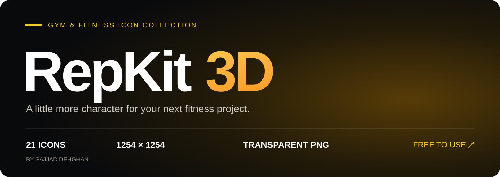

  <b>Warm colors. Tactile details. Ready for your next project.</b> 
  Gym equipment, workout essentials and a few playful extras.

  <a href="https://github.com/sajjad-dehghan/repkit-3d/archive/refs/heads/main.zip"><b>↓ Download the complete pack</b></a>
  &nbsp;&nbsp;·&nbsp;&nbsp; <a href="#the-collection">Explore all 21 icons</a>
  &nbsp;&nbsp;·&nbsp;&nbsp; <a href="linkedin/RepKit-3D.pdf">View the carousel</a>

---

## The collection

**21 individual icons · 1254 × 1254 px · Transparent PNG · CC0**

Every icon below links to its full-resolution file. All final assets live in one folder: [Gym-Fitness-Icons](Gym-Fitness-Icons).

## 01 / Built for the gym

The machines and benches at the heart of the collection.

<table>
<tr>
  <td align="center" width="33%">
    <a href="Gym-Fitness-Icons/03-flat-bench-press.png">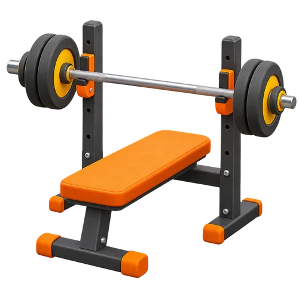</a> 
    03 <b>Flat bench press</b>  
  </td>
  <td align="center" width="33%">
    <a href="Gym-Fitness-Icons/07-lat-pulldown.png">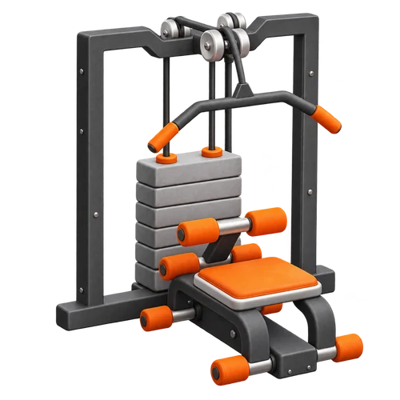</a> 
    07 <b>Lat pulldown</b>  
  </td>
  <td align="center" width="33%">
    <a href="Gym-Fitness-Icons/08-leg-press.png">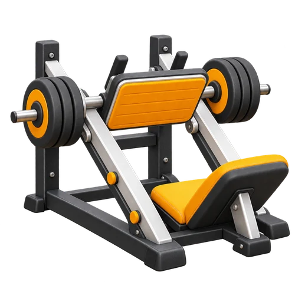</a> 
    08 <b>Leg press</b>  
  </td>
</tr>
<tr>
  <td align="center" width="33%">
    <a href="Gym-Fitness-Icons/09-smith-machine.png">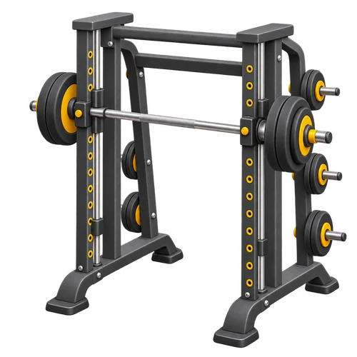</a> 
    09 <b>Smith machine</b>  
  </td>
  <td align="center" width="33%">
    <a href="Gym-Fitness-Icons/15-incline-bench.png">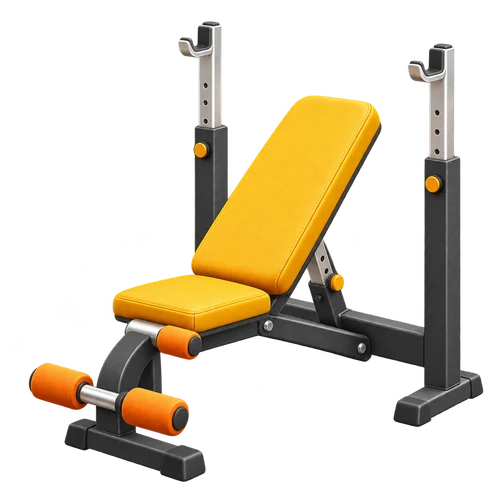</a> 
    15 <b>Incline bench</b>  
  </td>
  <td align="center" width="33%">
    <a href="Gym-Fitness-Icons/16-seated-shoulder-press.png">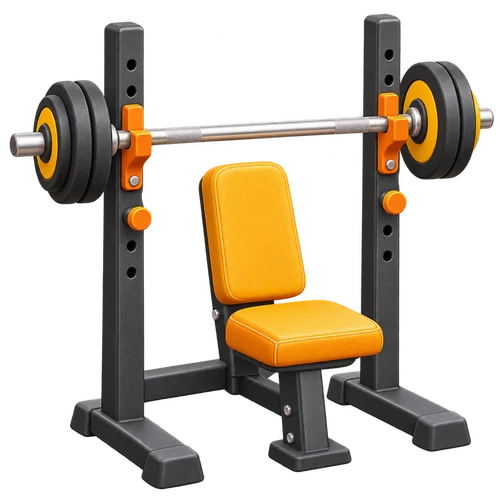</a> 
    16 <b>Seated shoulder press</b>  
  </td>
</tr>
</table>

## 02 / One more rep

Free weights, medicine balls and bodyweight equipment.

<table>
<tr>
  <td align="center" width="33%">
    <a href="Gym-Fitness-Icons/01-dumbbell.png">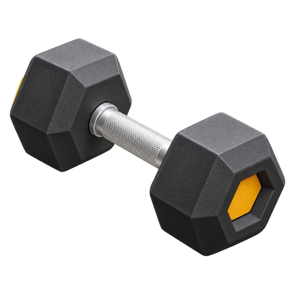</a> 
    01 <b>Dumbbell</b>  
  </td>
  <td align="center" width="33%">
    <a href="Gym-Fitness-Icons/02-barbell.png">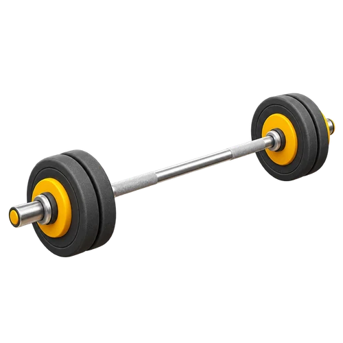</a> 
    02 <b>Barbell</b>  
  </td>
  <td align="center" width="33%">
    <a href="Gym-Fitness-Icons/06-kettlebell.png">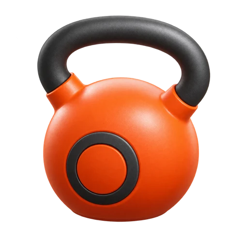</a> 
    06 <b>Kettlebell</b>  
  </td>
</tr>
<tr>
  <td align="center" width="33%">
    <a href="Gym-Fitness-Icons/10-medicine-ball-10kg.png">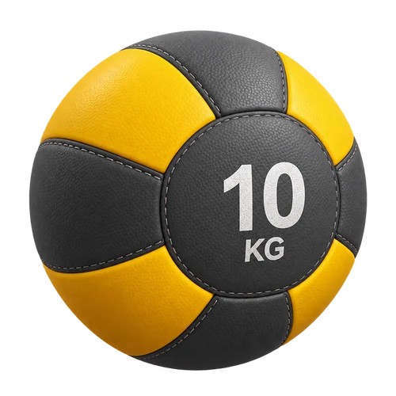</a> 
    10 <b>Medicine ball · 10 kg</b>  
  </td>
  <td align="center" width="33%">
    <a href="Gym-Fitness-Icons/11-medicine-ball-15kg.png">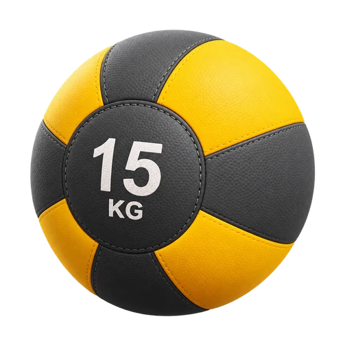</a> 
    11 <b>Medicine ball · 15 kg</b>  
  </td>
  <td align="center" width="33%">
    <a href="Gym-Fitness-Icons/14-pullup-dip-station.png">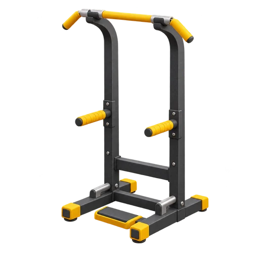</a> 
    14 <b>Pull-up &amp; dip station</b>  
  </td>
</tr>
</table>

## 03 / Keep moving

Cardio, tracking and the essentials around your workout.

<table>
<tr>
  <td align="center" width="33%">
    <a href="Gym-Fitness-Icons/04-punching-bag.png">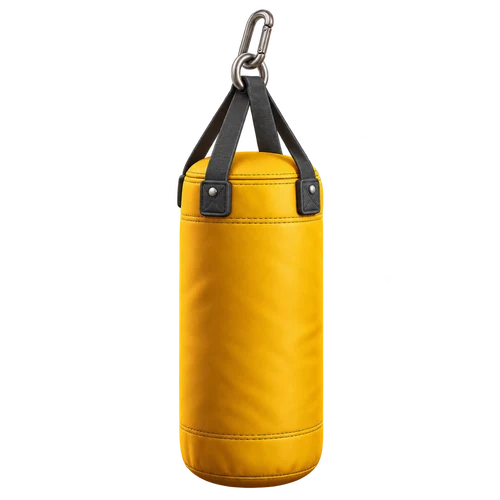</a> 
    04 <b>Punching bag</b>  
  </td>
  <td align="center" width="33%">
    <a href="Gym-Fitness-Icons/05-fitness-watch.png">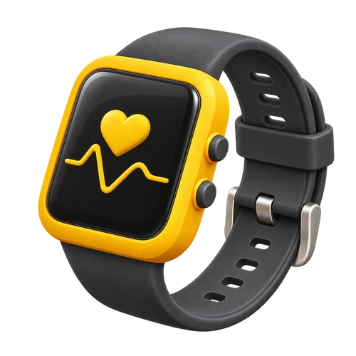</a> 
    05 <b>Fitness watch</b>  
  </td>
  <td align="center" width="33%">
    <a href="Gym-Fitness-Icons/12-exercise-mat.png">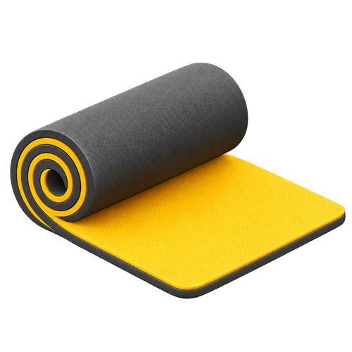</a> 
    12 <b>Exercise mat</b>  
  </td>
</tr>
<tr>
  <td align="center" width="33%">
    <a href="Gym-Fitness-Icons/13-jump-rope.png">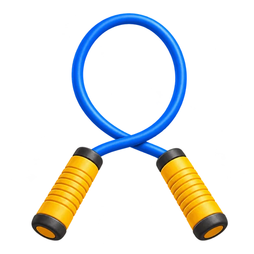</a> 
    13 <b>Jump rope</b>  
  </td>
  <td align="center" width="33%">
    <a href="Gym-Fitness-Icons/17-exercise-bike.png">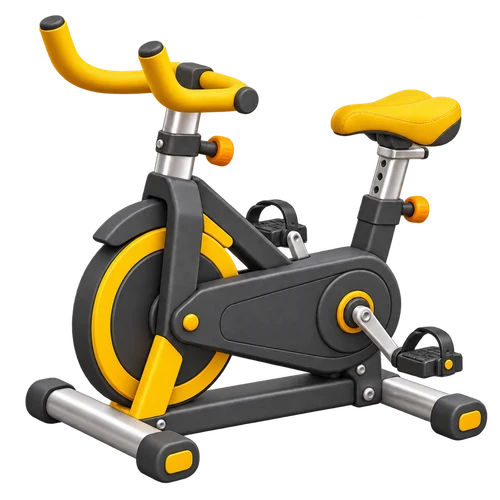</a> 
    17 <b>Exercise bike</b>  
  </td>
  <td align="center" width="33%">
    <a href="Gym-Fitness-Icons/18-treadmill.png">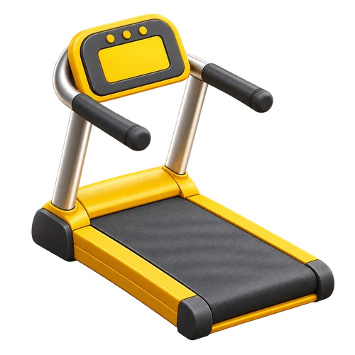</a> 
    18 <b>Treadmill</b>  
  </td>
</tr>
</table>

## 04 / A few extras

Hydration, a post-workout bowl and a way to find your gym.

<table>
<tr>
  <td align="center" width="33%">
    <a href="Gym-Fitness-Icons/19-sports-bottle.png">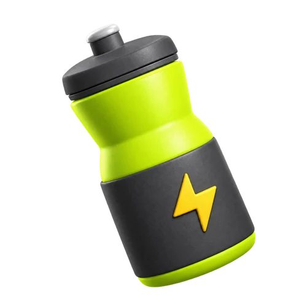</a> 
    19 <b>Sports bottle</b>  
  </td>
  <td align="center" width="33%">
    <a href="Gym-Fitness-Icons/20-ramen-bowl.png">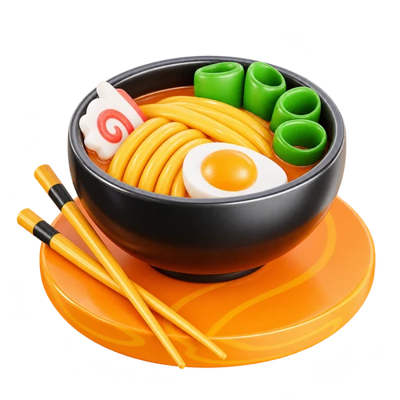</a> 
    20 <b>Ramen bowl</b>  
  </td>
  <td align="center" width="33%">
     
    21 <b>Map &amp; location</b>  
  </td>
</tr>
</table>

---

## Ready to drop into your design

1. **[Download the ZIP](https://github.com/sajjad-dehghan/repkit-3d/archive/refs/heads/main.zip)** and open `Gym-Fitness-Icons`.
2. **Pick a PNG** and drop it into Figma, your website or a presentation.
3. **Try a background.** Open `index.html` locally to preview the icons on dark, light and checkerboard backgrounds.

The icons are AI-generated raster illustrations with a 3D appearance, reviewed and refined for this collection. The pack contains PNG images, not editable 3D models.

## Share the collection

A six-slide Persian carousel is included, along with editable slides and individual images.

| LinkedIn PDF | Editable PowerPoint | Slide images | Persian caption |
| :---: | :---: | :---: | :---: |
| [Open PDF](linkedin/RepKit-3D.pdf) | [Download PPTX](linkedin/RepKit-3D.pptx) | [6 square PNGs](linkedin/slides) | [Read caption](linkedin/caption.txt) |

The PowerPoint uses Arial and [Vazir](https://github.com/rastikerdar/vazir-font). The PDF and PNGs preserve the finished layout.

## Yours to use

Released by **Sajjad Dehghan** under [CC0 1.0 Universal](LICENSE), to the extent of rights held. Personal projects, commercial work, edits and redistribution are welcome. Attribution is not required.

<b>معرفی فارسی</b>

### RepKit 3D

یه پک ۲۱تایی از آیکن‌های سه‌بعدی با رنگ‌های زرد، نارنجی و زغالی. از وسایل باشگاه و وزنه‌ها تا چندتا آیکن اضافه برای کامل‌تر شدن پروژه‌هات.

همهٔ آیکن‌ها PNG با پس‌زمینهٔ شفاف و ابعاد ۱۲۵۴ × ۱۲۵۴ پیکسل هستن. روی هر عکس بزنی، فایل کاملش باز می‌شه. برای دانلود همه‌شون هم لینک بالای صفحه رو بزن.

استفادهٔ شخصی و تجاری آزاده و نیازی به ذکر نام نیست. اگه به کارت اومد، خوشحال می‌شم ببینم باهاش چی ساختی :)

---

  <b>RepKit 3D</b> 
  A collection by <a href="https://github.com/sajjad-dehghan">Sajjad Dehghan</a>

